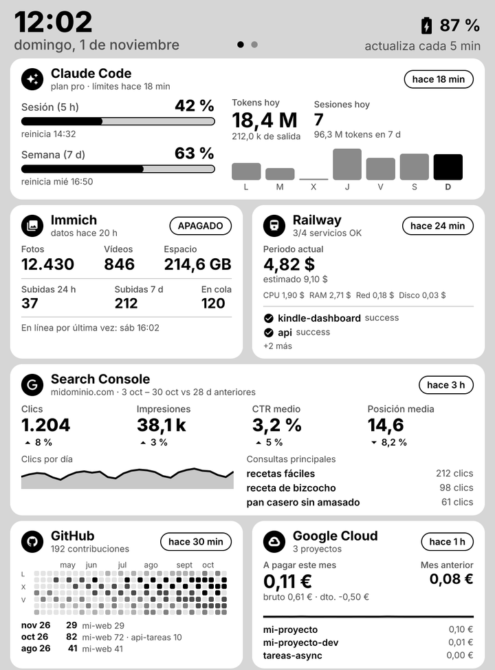
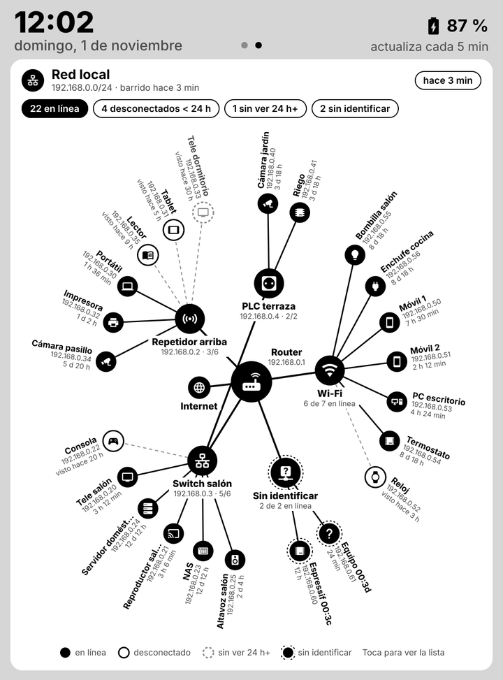
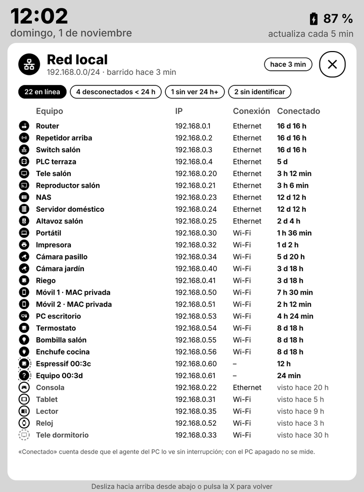

# Kindle Dashboard

Dashboard e-ink, para un Kindle con jailbreak: límites y tokens de Claude Code,
Immich, Railway, Search Console, GitHub, gasto de Google Cloud y un mapa de los dispositivos de la red local.
La misma imagen se ve en el navegador y como widget de escritorio en Windows (Rainmeter).

| Pantalla 1: métricas | Pantalla 2: red local | Detalle de la red |
|---|---|---|
|  |  |  |

Capturas generadas con `npm run preview` y datos de ejemplo.

## Qué hace

- **Tarjetas** con lo que importa de cada servicio; al tocar una se abre su **detalle** a pantalla completa.
- **Varias pantallas**: se desliza a izquierda y derecha, con un indicador de página en la cabecera.
- **Red local**: diagrama radial con el router en el centro, repetidores y switches alrededor y cada equipo en
  el anillo exterior, con su icono de tipo, IP y tiempo conectado. Sin credenciales del router.
  Explicado en [docs/red-local.md](docs/red-local.md).
- **Web** (`/web`) con los mismos dashboards, protegida con su propia clave.
- **Widget de escritorio** con fondo transparente, en tema claro u oscuro.
- Pantalla de **sin conexión** en el Kindle con la causa (sin red, clave incorrecta, servidor caído) y los pasos
  para arreglarlo.

## Cómo funciona

```
PC (cuando está encendido)              Servidor (Railway o el propio PC)           Kindle
agent/agent.mjs  ──POST /api/ingest──▶  server/index.js ── data/state.json
 · límites y tokens de Claude Code       · GitHub, Search Console, Railway,
 · Immich                                  gasto de Google Cloud (cada N min)
 · dispositivos de la red local          · GET /dash.png  ◀──────── cada 5 min ──── eips
                                         · GET /web, /widget.png
```

- El **servidor** guarda el último dato de cada fuente en un JSON y dibuja la imagen al pedirla: tarjetas en
  [satori](https://github.com/vercel/satori) y PNG de 8 bits en gris con [sharp](https://sharp.pixelplumbing.com),
  1072×1448, que el Kindle pinta con `eips` sin conversión.
- El **agente del PC** recoge lo que solo existe en local y lo envía con un token. Los secretos locales (token
  OAuth de Claude Code, clave de Immich) no salen del PC: al servidor solo llegan las cifras.
- El **Kindle** descarga la imagen cada pocos minutos con `curl` desde una extensión de KUAL y envía los toques
  como coordenadas; el servidor decide qué se ha tocado.

## Puesta en marcha

Necesitas **Node.js 22** o superior en el PC (y en el servidor, si no es el mismo) y un Kindle con jailbreak,
KUAL y acceso por SSH.

```powershell
npm install
copy .env.example .env               # claves del servidor y tokens de cada fuente
npm start                            # servidor en http://localhost:3000
npm run preview                      # genera out/preview*.png con datos de ejemplo
```

Después, cada parte tiene su guía:

| Guía | Contenido |
|---|---|
| [Servidor](docs/servidor.md) | Railway o PC local, variables, página web, memoria |
| [Fuentes de datos](docs/fuentes.md) | GitHub, Search Console, gasto de Google Cloud y Railway |
| [Agente del PC](docs/agente.md) | Claude Code, Immich, red local y tarea programada |
| [Red local](docs/red-local.md) | Cómo se descubren los equipos, inventario y límites |
| [Kindle](docs/kindle.md) | Extensión KUAL, gestos, varias pantallas y detalle |
| [Widget de escritorio](docs/widget.md) | Skin de Rainmeter con fondo transparente |

## Estructura

```
server/          servidor HTTP: recogida de las fuentes en la nube, estado y render
  collectors/    GitHub, Search Console, Railway y facturación de Google Cloud
  render/        tarjetas, detalles, diagrama de red y primitivas de UI para satori
agent/           agente del PC (Claude Code, Immich, red local) y su tarea programada
kindle/          extensión KUAL: bucle de descarga, gestos y pantalla de error
Rainmeter/       skin del widget de escritorio y su instalador
docs/            guías y capturas
tools/           vista previa HTML de la documentación
```

## Documentación en el navegador

Cada `.md` tiene al lado su `.html` (el README de la raíz, `index.html`) para leerla como páginas web:

```sh
npm install        # solo la primera vez
npm run docs       # vuelve a generar los .html tras cambiar algún .md
```

## Probado con

| Componente | Versión |
|---|---|
| Kindle | Paperwhite 3 (7.ª generación), firmware 5.16, 1072×1448 a 300 ppi |
| Node.js | 22 o superior |
| Agente y widget | Windows 11 |

## Créditos

- Tipografía [Inter](https://rsms.me/inter/), de Rasmus Andersson, bajo la
  [SIL Open Font License 1.1](https://openfontlicense.org) (paquete `@fontsource/inter`).
- Iconos de [Material Design Icons](https://pictogrammers.com/library/mdi/) (`@mdi/js`), bajo licencia
  [Apache 2.0](https://www.apache.org/licenses/LICENSE-2.0).
- [satori](https://github.com/vercel/satori) (MPL 2.0) y [sharp](https://sharp.pixelplumbing.com) (Apache 2.0)
  para el render.
- En el Kindle, los gestos y la pantalla de error usan el LuaJIT y FBInk que trae
  [KOReader](https://koreader.rocks) (AGPL 3.0); no se incluyen en este repositorio.

## Licencia

[MIT](LICENSE).
