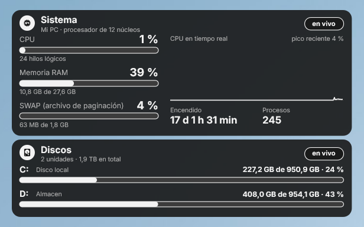
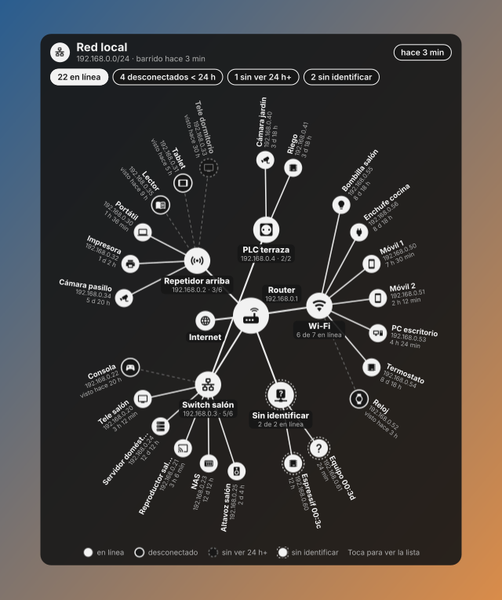
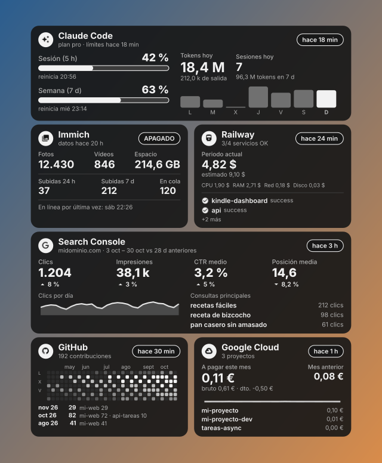

# Widgets de escritorio (Rainmeter)

Tres pieles de [Rainmeter](https://www.rainmeter.net) con el mismo diseño que las tarjetas del Kindle y la web.
Van **en el escritorio**: encima del fondo de Windows y debajo de todas las ventanas, con fondo transparente y en
tema oscuro o claro.

| Telemetría del PC | Red local | Métricas |
|---|---|---|
|  |  |  |

| Piel | De dónde salen los datos | Necesita el servidor |
|---|---|---|
| **Inkboard** (`-Page 0`): métricas | Descarga `/widget.png` del servidor cada 5 minutos | Sí |
| **Inkboard** (`-Page 1`): red local | Descarga `/widget.png?page=1` del servidor cada 5 minutos | Sí |
| **Telemetría** | Lee el propio PC con las medidas de Rainmeter (CPU, memoria, contadores de Windows, discos), cada segundo | No |

Las capturas de métricas y red están generadas con `npm run preview` y datos de ejemplo; la de telemetría es del
widget real, con un subtítulo genérico en lugar del nombre del equipo y el procesador.

Requiere Rainmeter: `winget install Rainmeter.Rainmeter`.

## Métricas y red local

```powershell
powershell -ExecutionPolicy Bypass -File Rainmeter\install.ps1 -ServerUrl https://TU-APP.up.railway.app            # métricas, monitor 1, a la derecha
powershell -ExecutionPolicy Bypass -File Rainmeter\install.ps1 -ServerUrl https://TU-APP.up.railway.app -Page 1    # red local
```

| Parámetro | Por defecto | Para qué |
|---|---|---|
| `-ServerUrl` | `http://localhost:3000` | Servidor de Inkboard |
| `-Key` | `DASH_KEY` del `.env` del repositorio | Clave del dashboard |
| `-Page` | `0` | Pantalla: `0` métricas, `1` red local |
| `-Width` | `700` | Ancho en píxeles; el alto es el de las tarjetas |
| `-Theme` | `dark` | `dark` (tarjetas oscuras) o `light` (tarjetas blancas, como el Kindle) |
| `-Monitor` | `1` | Monitor de Rainmeter (1 = el primero) |
| `-Align` | `1` | `1` derecha, `0` izquierda |
| `-Margin` | `24` | Separación del borde del monitor |
| `-OffsetX` | `0` | Desplazamiento extra desde ese borde, para poner varios widgets en fila |
| `-RefreshMinutes` | `5` | Cada cuántos minutos se descarga la imagen |

El instalador copia la piel a `Documentos\Rainmeter\Skins\Inkboard` (o `Inkboard-Pantalla<N+1>` para `-Page N`),
crea `@Resources\Variables.inc` con esos valores y la carga. Un clic abre `/web`; el menú del botón derecho tiene
«Abrir en el navegador» y «Actualizar ahora».

`/widget.png?key=DASH_KEY&w=700&theme=dark&page=0` dibuja las tarjetas sin la cabecera de hora y fecha del Kindle
(ya están en la barra de tareas) y con su alto natural. Con `&header=1` vuelve la cabecera y el alto sigue la
proporción del Kindle.

## Telemetría del PC

```powershell
powershell -ExecutionPolicy Bypass -File Rainmeter\install-telemetria.ps1                         # 700 px, monitor 1, a la izquierda
powershell -ExecutionPolicy Bypass -File Rainmeter\install-telemetria.ps1 -Width 600 -Theme light
powershell -ExecutionPolicy Bypass -File Rainmeter\install-telemetria.ps1 -Subtitle "PC del estudio"
```

- **Sistema**: CPU, RAM y SWAP (el archivo de paginación de Windows) con porcentaje, barra y cifras; gráfica de la
  CPU en tiempo real con su pico reciente; tiempo encendido y número de procesos.
- **Discos**: cada unidad fija (hasta 6) con su espacio usado, la capacidad total y el porcentaje.

Se actualiza cada segundo (los discos, cada 30 s). Con el botón derecho: Administrador de tareas o Explorador.

Acepta `-Width`, `-Theme`, `-Monitor`, `-Align` (por defecto `0`, izquierda), `-Margin` y `-OffsetX` como la otra
piel, y además `-Subtitle`: el texto bajo «Sistema», que por defecto es el nombre del equipo y el procesador. Copia
la piel a `Documentos\Rainmeter\Skins\Inkboard-Telemetria`, escribe `Variables.inc` y detecta los discos fijos en
`Disks.inc`; si conectas otro disco, vuelve a ejecutarlo.

| Archivo | Qué es |
|---|---|
| `Rainmeter/Telemetria/Telemetry.ini` | La piel. Generada por `tools/telemetria-ini.cjs` |
| `@Resources/Telemetry.lua` | Formatea los textos como el dashboard: coma decimal, GB/TB en base 1024, «42 %». En UTF-16 LE para que Rainmeter muestre bien las tildes |
| `@Resources/Fonts` | Inter en TTF (Rainmeter la carga sin instalarla en Windows), con su licencia |
| `@Resources/Themes` | Colores de cada tema: tarjeta, tinta, texto secundario, pista de las barras y relleno de la gráfica |
| `@Resources/Images` | Insignias de las tarjetas, una por tema. Generadas por `tools/telemetria-assets.cjs` |

Para cambiar el diseño, edita `tools/telemetria-ini.cjs` y regenera con `node tools/telemetria-ini.cjs`. Las
medidas siguen el diseño de las tarjetas a 1072 px de ancho y se escalan con `#S#` (`Width / 1072`); las fuentes van
en puntos (`px × 0,75 × escala`). Las fuentes y las insignias se regeneran con `node tools/telemetria-assets.cjs`
(usa `sharp`, `@mdi/js` y `@fontsource/inter` del proyecto).

## Varios widgets en fila

Rainmeter carga una sola piel por carpeta, así que cada widget tiene la suya y se pueden ver todos a la vez. Para
ponerlos en fila sin que se pisen, usa `-OffsetX` con el ancho de los que quedan entre el widget y el borde, más la
separación. Por ejemplo, telemetría y red a la izquierda y métricas a la derecha:

```powershell
powershell -ExecutionPolicy Bypass -File Rainmeter\install-telemetria.ps1 -Width 600 -Align 0
powershell -ExecutionPolicy Bypass -File Rainmeter\install.ps1 -ServerUrl https://TU-APP.up.railway.app -Page 1 -Align 0 -OffsetX 624   # 600 + 24
powershell -ExecutionPolicy Bypass -File Rainmeter\install.ps1 -ServerUrl https://TU-APP.up.railway.app -Page 0 -Align 1
```

Para quitar uno, descárgalo desde Rainmeter (clic derecho → **Descargar skin**) o borra su carpeta. Para cambiar
algo a mano, edita su `@Resources\Variables.inc` y refresca la piel. `Variables.inc` y `Disks.inc` se generan en
cada PC y no se suben a git.
