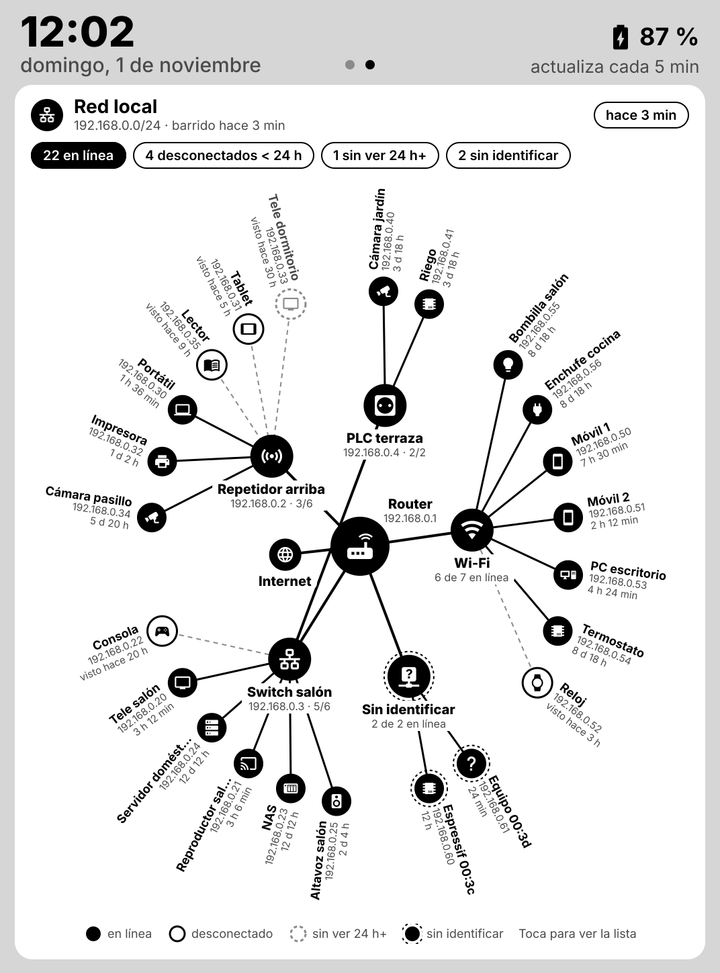
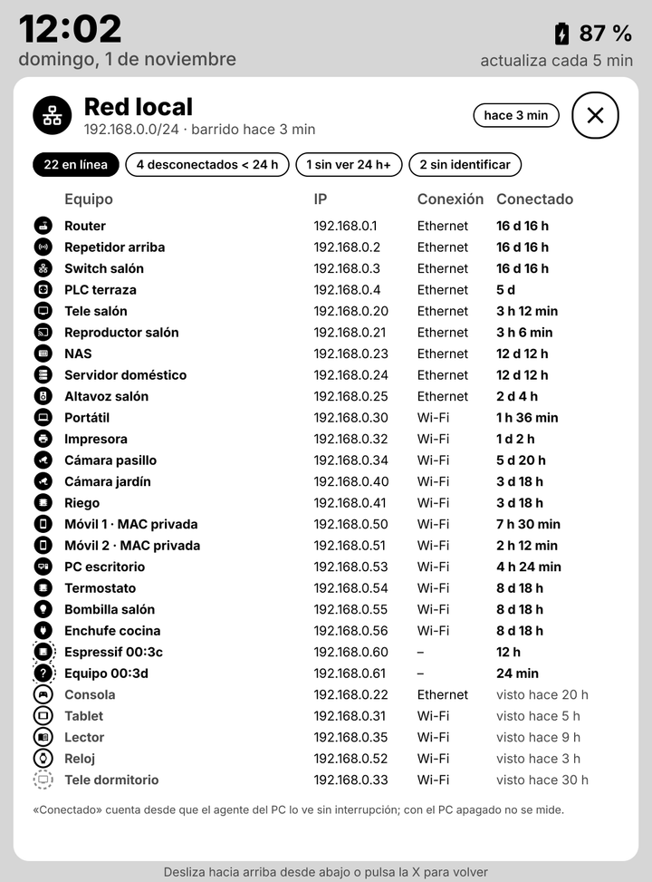

# Red local

La segunda pantalla dibuja los dispositivos de casa como un diagrama radial: el router en el centro, los
repetidores, switches y PLC alrededor y cada equipo en el anillo exterior, con su icono de tipo, su IP y el
tiempo que lleva conectado (o cuándo se vio por última vez). Al tocar el diagrama se abre la lista completa.

| Diagrama | Lista de equipos |
|---|---|
|  |  |

## Cómo se leen

| Forma | Significado |
|---|---|
| Círculo negro, línea continua | En línea en el último barrido |
| Círculo blanco con borde, línea discontinua | Desconectado hace menos de 24 h, o un equipo marcado con `sleeps` |
| Círculo gris discontinuo | Sin ver desde hace 24 h o más |
| Anillo punteado alrededor | Sin identificar: no está en el inventario |
| Nodo **Wi-Fi** / **Ethernet** | Grupos de los equipos del inventario que no cuelgan de un repetidor o switch concreto |
| Nodo **Sin identificar** | Equipos que aparecen en la red y no están en el inventario |

Las cifras de arriba cuentan los equipos en línea, los desconectados hace menos de 24 h, los que llevan más de
un día sin verse y los que faltan por identificar.

## De dónde salen los datos

Lo descubre el [agente del PC](agente.md) (`agent/network.mjs`) en cada pasada, sin credenciales y sin cambiar
nada en la red:

1. **Sondeo ARP.** Envía un datagrama UDP vacío a cada IP de la subred del PC. Para poder enviarlo, el sistema
   tiene que preguntar por ARP quién tiene esa IP, y todo equipo encendido responde a ARP aunque su cortafuegos
   ignore el ping: sin ARP no podría comunicarse en la red. Unos segundos después, las entradas *alcanzables*
   de la tabla de vecinos (`Get-NetNeighbor` en Windows, `ip neigh` en Linux) son los equipos en línea. En la
   práctica encuentra bastantes más equipos que un barrido con ping, que muchos móviles y aparatos de domótica
   ignoran.
2. **Nombres y tipo.** Para cada equipo en línea se consultan, en paralelo y solo dentro de la subred:
   - **mDNS** (búsqueda inversa `d.c.b.a.in-addr.arpa`): móviles, Apple, Linux, impresoras, Android TV.
   - **NetBIOS** (consulta de estado, UDP 137): PCs con Windows y algunos NAS.
   - **SSDP/UPnP**: teles, reproductores, consolas y routers publican una descripción XML con nombre y modelo.
     Solo se lee la descripción servida por el propio equipo que respondió.
   - **DNS inverso** del router, si lo ofrece.
   - El fabricante de la MAC para los chips más comunes en domótica (Espressif).

   Con esas pistas se adivina el tipo (televisor, móvil, impresora…), pero manda el inventario.
3. **Historial** en `agent/state.json`: primera vez que se vio cada MAC, desde cuándo está en línea sin
   interrupción y la última vez que se vio.

Al servidor llega solo la lista resultante. Si el servidor está en la nube, ten en cuenta que esa lista (MAC,
IP y nombres de tus equipos) se guarda allí, en `state.json`, protegida por `DASH_KEY` y `WEB_KEY`.

## Inventario: `agent/devices.json`

El descubrimiento por la red no puede saber si un equipo va por **Wi-Fi o por cable**, ni de qué repetidor
cuelga, y muchos equipos no anuncian un nombre útil. El inventario completa esa información y hace que los
equipos apagados sigan apareciendo (como desconectados) en lugar de desaparecer:

```powershell
copy agent\devices.example.json agent\devices.json
```

```json
{
  "devices": [
    { "mac": "aa:bb:cc:00:00:01", "name": "Repetidor planta alta", "type": "ap", "link": "ethernet", "parent": "router" },
    { "mac": "aa:bb:cc:00:00:10", "name": "Tele salón", "type": "tv", "link": "ethernet", "parent": "aa:bb:cc:00:00:02" },
    { "mac": "aa:bb:cc:00:00:13", "name": "Kindle", "type": "ereader", "link": "wifi", "sleeps": true }
  ]
}
```

| Campo | Valores |
|---|---|
| `mac` | Obligatorio, con `:` o `-` |
| `name` | Nombre que se muestra |
| `type` | `router`, `ap`, `switch`, `powerline`, `tv`, `streamer`, `pc`, `laptop`, `tablet`, `phone`, `ereader`, `console`, `printer`, `speaker`, `camera`, `nas`, `server`, `iot`, `light`, `plug`, `watch` |
| `link` | `wifi` o `ethernet` |
| `parent` | MAC del repetidor, switch o PLC del que cuelga, o `router`. Sin `parent`, va al grupo Wi-Fi o Ethernet |
| `sleeps` | `true` si se apaga o duerme a menudo (Kindle, tablets): desconectado no cuenta como aviso |

Las MAC de los equipos nuevos salen en la lista de detalle y en `node agent\agent.mjs --dry-run`; las últimas
cifras aparecen también en el nombre provisional (`Espressif 6f:7c`, `Equipo 34:4f`).

Los móviles y tablets usan **MAC privada** por red (la lista lo indica). Suele ser fija para cada red Wi-Fi, así
que sirve para el inventario; si un móvil la rota, aparecerá como equipo nuevo. Se puede desactivar en los
ajustes Wi-Fi del móvil para la red de casa.

## Router con credenciales o descubrimiento por la red

| | Router con credenciales | Descubrimiento por la red (lo que hace el agente) |
|---|---|---|
| Equipos encendidos | Todos los que tienen concesión DHCP o están asociados a la Wi-Fi | Todos los que responden a ARP en la subred del PC |
| Equipos dormidos o apagados | Siguen en la lista mientras dure la concesión | Desaparecen; el inventario los mantiene como desconectados |
| Wi-Fi o cable, banda, señal | Sí | No (se indica en el inventario) |
| Tiempo conectado | Tiempo real de asociación Wi-Fi, en muchos routers | Desde que el agente lo ve sin interrupción, solo con el PC encendido |
| Nombres | Nombre DHCP de cada equipo | mDNS, NetBIOS, SSDP o inventario |
| Red de invitados y aislamiento de clientes | Visible | No visible |
| Riesgo | Hay que guardar la contraseña de administración del router, que da control total sobre la red; el acceso suele ser por HTTP sin cifrar, con una API distinta por modelo y firmware, y en muchos routers una sesión del agente cierra la del navegador | Solo lectura, sin credenciales, sin abrir puertos ni cambiar nada en el router |

**Ninguna de las dos garantiza el 100 %.** El router es la fuente más completa porque es quien reparte las IP y
asocia los equipos Wi-Fi, pero tampoco ve los equipos con IP fija en un switch que nunca han hablado con él, y
su lista de concesiones incluye equipos que ya se fueron. El descubrimiento por la red ve todo lo que está
encendido en la misma subred, porque responder a ARP es obligatorio para comunicarse, y falla con lo que está
apagado, dormido con la Wi-Fi desactivada (lectores de tinta electrónica, algunos relojes), en la red de
invitados o en otra subred.

Por eso el proyecto combina **descubrimiento por la red + inventario**: es seguro (sin contraseñas), funciona
con cualquier router y el inventario cubre lo que la red no puede saber. Para no olvidar ninguno, revisa de vez
en cuando el grupo *Sin identificar* y añade cada MAC nueva al inventario: desde ese momento, el equipo aparece
siempre, esté encendido o no.

## Límites

- Solo se ve la subred del PC (si es mayor que /22, la /24 del PC). Una red de invitados u otra VLAN necesitan
  un agente dentro de ella.
- El tiempo conectado empieza de cero cuando el PC se enciende o cuando hay más de 15 minutos entre dos pasadas.
  Con el PC apagado, la pantalla muestra la última foto conocida y lo indica en la cabecera («PC apagado»).
- El propio PC aparece con su nombre de equipo y como en línea mientras el agente funciona.
- Caben unos 45 equipos en el diagrama y 28 en la lista; con más, la lista muestra cuántos quedan fuera.
