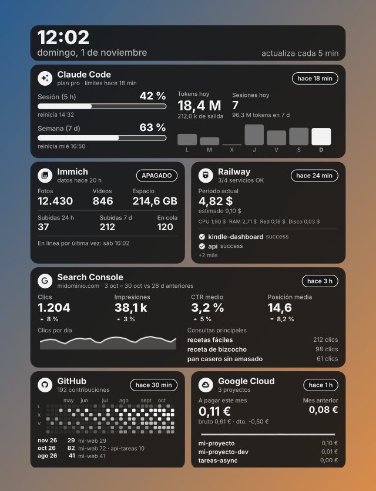

# Widget de escritorio

`GET /widget.png?key=DASH_KEY&w=700&theme=dark` dibuja el dashboard con **fondo transparente** al ancho pedido
(240–2144 px; el alto sigue la proporción del Kindle), en tema `dark` (tarjetas oscuras, texto claro) o `light`
(tarjetas blancas, texto negro, como el Kindle). Con `&page=N` se elige la pantalla.



El skin de `Rainmeter/` lo descarga cada 5 minutos y lo pinta **en el escritorio**: encima del fondo de Windows y
debajo de todas las ventanas. Un clic abre `/web`; el menú del botón derecho tiene «Abrir en el navegador» y
«Actualizar ahora». Requiere [Rainmeter](https://www.rainmeter.net) (`winget install Rainmeter.Rainmeter`).

```powershell
powershell -ExecutionPolicy Bypass -File Rainmeter\install.ps1 -ServerUrl https://TU-APP.up.railway.app   # 700 px, monitor 1, a la derecha
powershell -ExecutionPolicy Bypass -File Rainmeter\install.ps1 -Width 600 -Monitor 2 -Align 0              # servidor local, 600 px, monitor 2, a la izquierda
powershell -ExecutionPolicy Bypass -File Rainmeter\install.ps1 -Theme light                                # tema claro, como el Kindle
```

Sin `-ServerUrl`, el widget usa `http://localhost:3000`.

El instalador copia el skin a `Documentos\Rainmeter\Skins\KindleDashboard`, crea `@Resources\Variables.inc` con la
`DASH_KEY` del `.env` del repositorio (o la de `-Key`) y lo carga. `Variables.inc` no se sube a git. Para cambiar
algo a mano, edita ese archivo (servidor, clave, ancho, tema, monitor, lado, margen, frecuencia) y refresca el
skin. Los iconos del escritorio quedan por encima del widget.
